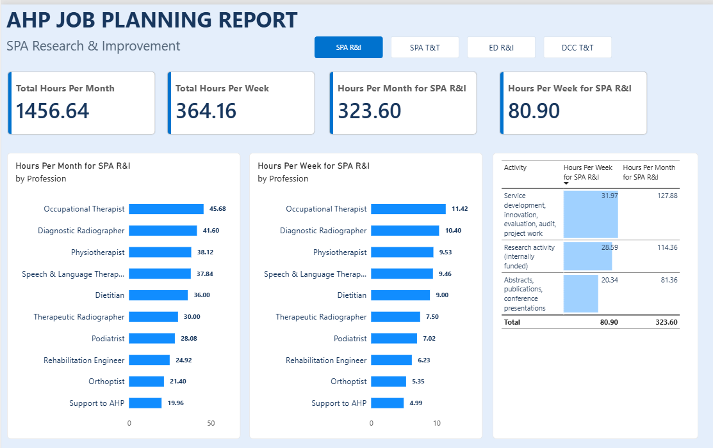
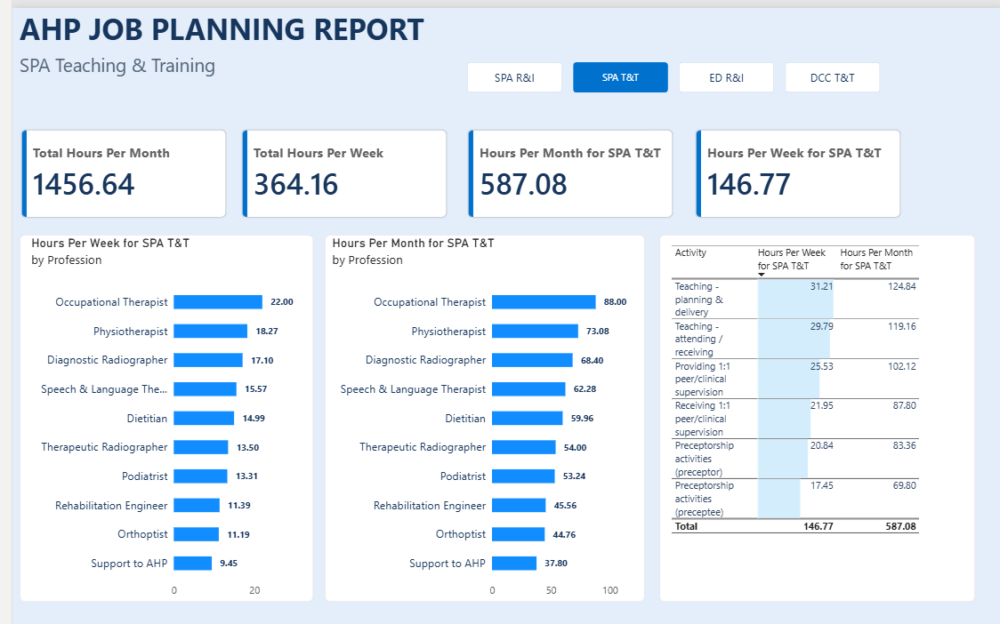
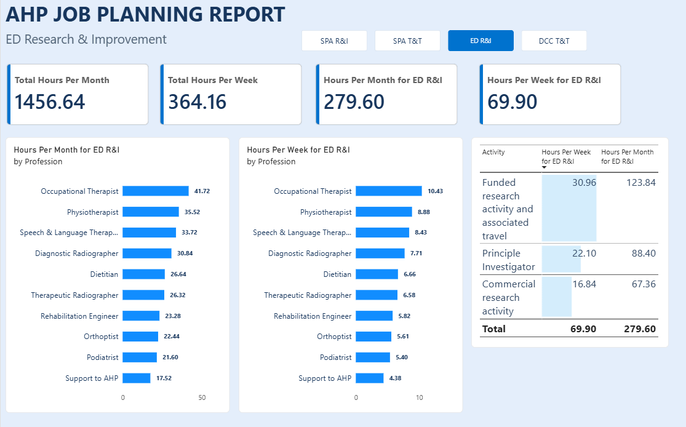
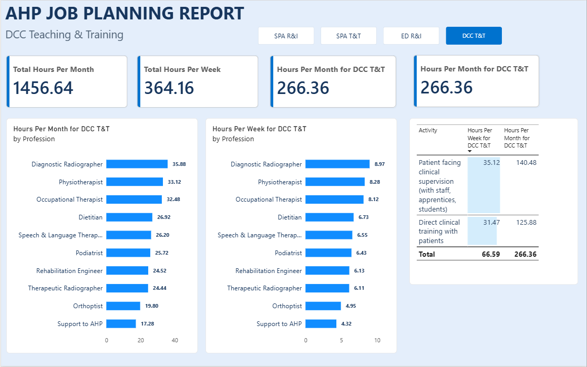

# Workforce Job Planning Analysis | Power BI

## Project Overview

This project demonstrates an end-to-end workforce job-planning analysis developed in response to a real management reporting requirement within a healthcare workforce setting.

The objective was to analyse planned workforce activity across selected **Research & Improvement** and **Teaching & Training** categories, with a particular focus on:

- planned hours by profession;
- weekly and monthly workforce allocation;
- comparison of activity across professional groups;
- detailed breakdown of specific job-planning activities.

The solution was developed using **Excel, Power Query, dimensional data modelling, DAX and Power BI**.

The original operational report supported a one-off management request. This public portfolio version recreates the analytical solution using **fully synthetic data**.

---

## Data Governance and Confidentiality

The original project was developed using internal organisational workforce data.

To protect confidentiality and comply with information-governance requirements:

- no original employee-level data is included in this repository;
- no genuine job-plan identifiers are included;
- no original organisational totals are published;
- no original Excel source file is included;
- the public Power BI report uses completely synthetic data;
- synthetic values were generated independently rather than by scaling or masking the original figures;
- all screenshots included in this repository are taken from the synthetic portfolio version.

The synthetic dataset preserves the **structure, analytical logic and reporting requirements** of the original project while ensuring that the published figures do not represent actual organisational activity.

---

## Business Requirement

The management requirement was to produce a one-off workforce report showing planned hours **by profession**, reported both **per week** and **per month**, across four key areas.

### 1. SPA Research & Improvement

Analysis was required for:

- Abstracts, publications and conference presentations
- Research activity (internally funded)
- Service development, innovation, evaluation, audit and project work

### 2. ED Research & Improvement

Analysis was required for:

- Commercial research activity
- Funded research activity and associated travel
- Principal Investigator activity

### 3. DCC Teaching & Training

Analysis was required for:

- Direct clinical training with patients
- Patient-facing clinical supervision with staff, apprentices and students

### 4. SPA Teaching & Training

Analysis was required for:

- Preceptorship activities – preceptee
- Preceptorship activities – preceptor
- Providing 1:1 peer/clinical supervision
- Receiving 1:1 peer/clinical supervision
- Teaching – attending/receiving
- Teaching – planning and delivery

---

## Solution Workflow

The analysis followed a structured workflow from initial data preparation through to management reporting.

```text
Management Requirement
        ↓
Excel Preparation
        ↓
Power Query Transformation
        ↓
Dimensional Data Model
        ↓
DAX Measures
        ↓
Power BI Dashboard
        ↓
Management Reporting
```

### 1. Excel Data Preparation

The source workforce data was initially reviewed and prepared in Excel before being loaded into Power BI.

A monthly planned-hours field was derived using:

```text
Hours Per Month = Hours Per Week × 4
```

A four-week reporting convention was used to provide the monthly equivalent required for this analysis.

The original operational Excel workbook is not included in this public repository.

### 2. Power Query Transformation

Power Query was used to prepare the dataset for modelling and analysis.

Key transformation steps included:

- assigning appropriate data types;
- removing the `Preferred Name` field;
- combining `Category` and `Subcategory` into a new `CombinedCategory` field;
- filtering records where the combined category or activity was blank;
- generating a sequential index;
- renaming the index to `ActivityID`;
- preparing the transformed dataset for dimensional modelling.

The `CombinedCategory` field was created using:

```powerquery
[Category] & " " & [Subcategory]
```

This created reporting groups including:

```text
SPA Research & Improvement
ED Research & Improvement
DCC Teaching & Training
SPA Teaching & Training
```

---

## Data Model

The transformed activity data was organised into a dimensional model containing a fact table and supporting dimension tables.

```text
Dim_Profession
      |
      | 1
      |
      | *
Fact_Activity
      *
      |
      | 1
      |
Dim_Category
```

### Fact Table

`Fact_Activity`

Contains the activity-level records and numerical measures used in the analysis, including:

- Activity
- ActivityID
- Hours Per Week
- Hours Per Month
- Profession key
- Category key

### Dimension Tables

`Dim_Profession` contains the professional groups used to analyse workforce allocation by profession.

`Dim_Category` contains the category, subcategory and combined reporting groups used throughout the analysis.

---

## DAX Measures

Reusable DAX measures were created for weekly and monthly workforce hours.

### Base Measures

```DAX
Total Hours Per Week =
SUM ( Fact_Activity[Hours per week] )
```

```DAX
Total Hours Per Month =
SUM ( Fact_Activity[Hours Per Month] )
```

Category-specific measures were then created using `CALCULATE`.

Example:

```DAX
Hours Per Week for SPA R&I =
CALCULATE (
    [Total Hours Per Week],
    Dim_Category[CombinedCategory] = "SPA Research & Improvement"
)
```

The same pattern was applied to:

- SPA Research & Improvement
- ED Research & Improvement
- DCC Teaching & Training
- SPA Teaching & Training

Full DAX documentation is available in [`documentation/dax_measures.md`](documentation/dax_measures.md).

---

## Power BI Dashboard

The final report was designed as a multi-page Power BI dashboard covering the four required workforce activity areas.

### SPA Research & Improvement



This page summarises planned weekly and monthly hours for SPA Research & Improvement activities by profession and activity type.

### SPA Teaching & Training



This page shows planned workforce allocation for SPA Teaching & Training activities, including supervision, preceptorship and teaching activity.

### ED Research & Improvement



This page analyses planned hours associated with ED Research & Improvement activities, including funded research and investigator activity.

### DCC Teaching & Training



This page focuses on DCC Teaching & Training activity, including direct clinical training and patient-facing clinical supervision.

---

## Dashboard Features

The Power BI solution includes:

- weekly and monthly planned-hours KPI cards;
- profession-level comparisons;
- activity-level breakdowns;
- category-specific analysis;
- interactive filtering;
- page navigation;
- consistent visual design across all four reporting areas.

All figures shown in the public dashboard screenshots are synthetic.

---

## Tools Used

| Tool | Purpose |
|---|---|
| **Microsoft Excel** | Initial data review and monthly-hours calculation |
| **Power Query** | Data cleaning, transformation and preparation |
| **Power BI** | Data modelling, analysis and dashboard development |
| **DAX** | Reusable workforce-hour measures and category calculations |
| **GitHub** | Technical documentation and portfolio presentation |

---

## Key Skills Demonstrated

This project demonstrates practical experience in:

- translating stakeholder requirements into analytical outputs;
- workforce-data preparation and transformation;
- creating calculated fields and business rules;
- using Power Query for repeatable data preparation;
- dimensional data modelling;
- creating fact and dimension tables;
- defining table relationships;
- writing reusable DAX measures;
- applying filter context using `CALCULATE`;
- analysing workforce activity by profession;
- developing multi-page Power BI reports;
- presenting high-level KPIs alongside detailed activity analysis;
- applying data-governance principles to portfolio publication;
- documenting an end-to-end analytical solution.

---

## Technical Documentation

Additional project documentation is available here:

- [Data Model](documentation/data_model.md)
- [Power Query Transformations](documentation/power_query_transformations.md)
- [DAX Measures](documentation/dax_measures.md)
- [Project Methodology](documentation/project_methodology.md)

---

## Repository Structure

```text
workforce-job-planning-analysis/
│
├── README.md
│
├── powerbi/
│   └── Workforce_Job_Planning_Portfolio.pbix
│
├── images/
│   ├── spa-research-improvement.png
│   ├── spa-teaching-training.png
│   ├── ed-research-improvement.png
│   └── dcc-teaching-training.png
│
└── documentation/
    ├── data_model.md
    ├── power_query_transformations.md
    ├── dax_measures.md
    └── project_methodology.md
```

The Power BI file included in this repository contains **synthetic data only**.

---

## Portfolio Note

This project is based on a real workforce reporting requirement completed in a professional healthcare setting.

The public version was recreated specifically for portfolio use. The analytical approach, transformation logic, dimensional modelling, DAX methodology and dashboard design reflect the original solution, while all published data values are synthetic.

This allows the technical work and problem-solving approach to be demonstrated without exposing confidential organisational or employee information.
